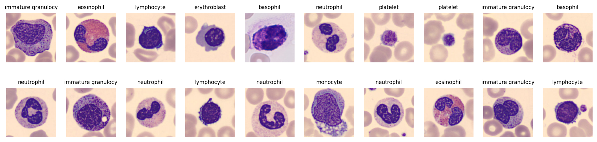

# Eight-Class Blood Cell Classification from Microscopy Images Using a Scratch CNN and Pretrained ResNet-18

**Biomedical Image Analysis · M.Sc. Applied Data Science and AI · SRH University Munich · Winter semester 2026/27**
**Author(s):** Ishika Thakur , Sushma  · **Repository:** https://github.com/Sushmanayak2000/Biomedical_Image_Analysis · **Date:** [date]

> How to use this template: copy it into your repository as `report.md` (or into LaTeX or Word with the same sections).
> Replace everything in [square brackets]. The section titles follow the eight grading criteria of Session 1 (weights in brackets).
> The remaining criterion, code understanding and technical defense (15 %), is graded in the exam conversation, not in the report.
> Same structure as the Deep Learning report, plus the biomedical parts: modality, labels, patient-level split, clinical meaning.
> Shared data or paper with Deep Learning? Allowed (decided 15.10.): different questions; data preparation is graded here only; name the shared work in both reports.

---

## Abstract

[Four or five sentences: the clinical question, the data, your classical baseline, your deep-learning model, the result with its spread, what it means and what it does not.]

## 1 · The biomedical problem (15 %, with section 2)

- **Clinical question:** How effectively can CNN-based models, including a CNN trained from scratch and an ImageNet-pretrained ResNet-18, classify eight types of blood cells from microscopy images?
- **Task type:** Multiclass image classification. The input is a 128 × 128 RGB microscopy image of an individual blood cell. The output is a predicted label corresponding to one of eight blood cell types.
- **Why it is hard:** Some blood cell types have visually similar characteristics. Distinguishing them may require identifying subtle differences in nucleus shape, staining patterns, and cellular texture. Differences in the number of images available for each class may also affect model performance, meaning that overall accuracy alone may not adequately represent classification performance across all eight classes.

## 2 · The data (15 %, with section 1)

| Item | Description |
|---|---|
| Source, version, download date | BloodMNIST 128×128 dataset, downloaded directly from Zenodo (Record 10519652). Dataset file: bloodmnist_128.npz. Source: https://zenodo.org/records/10519652, Download date: [12/11/2026].|
| Licence | Creative Commons Attribution 4.0 International (CC BY 4.0). The dataset can be shared, modified and used commercially, provided the original creators are credited and changes are acknowledged.|
| Modality | Two-dimensional RGB microscopy images of individual blood cells. |
| Size |17,092 images, each with a resolution of 128 × 128 pixels, belonging to 8 classes. Patient count is not reported in the dataset documentation. |
| Labels: who made them | The blood cell images were labelled by clinical pathologists at the Hospital Clínic of Barcelona (Acevedo et al., 2020).|
| Labels: agreement | Not reported. |
| Classes or targets | Eight blood cell types: Basophil, Eosinophil, Erythroblast, Immature Granulocytes, Lymphocyte, Monocyte, Neutrophil and Platelet |
| Splits | The official training (11,959 images), validation (1,712 images) and test (3,421 images) splits provided with BloodMNIST were used. Patient-level separation could not be independently verified because patient IDs were unavailable. |
| Preprocessing | Original 128 × 128 RGB images were resized to 224 × 224 pixels and normalised using ImageNet mean and standard deviation. Training images were augmented using horizontal and vertical flips and random rotation (±15°). |
| Quality checks | [Summarize the visual review of 20 images and the duplicate checks. Report what you found.] |
| Shared with Deep Learning? | No. The Deep Learning project used EuroSAT satellite images. |

*Figure 1. Representative 128 × 128 RGB microscopy images from BloodMNIST. The label above each image identifies the cell type.*

## 3 · Experimental design (15 %)

- **The floor:** [the trivial answer: largest class, or "always background" (Dice 0)]
- **Classical baseline:** [threshold, features + random forest, … (Sessions 5–6)]
- **Deep-learning model:** [architecture, pretrained or not, 2D/2.5D/3D, loss (Dice + cross-entropy?), why]
- **Augmentation:** [which changes, and why each one is plausible for this modality (Session 8)]
- **Comparisons:** [one change at a time; same splits and budget; at least three seeds]

## 4 · Implementation and reproducibility (25 %)

- **Run it:** [commands or notebook order; environment, for example `requirements.txt`]
- **Seeds, hardware, training time:** […]
- **Where the results come from:** [which notebook or script makes which table and figure]

## 5 · Evaluation, validation and critical analysis (15 %)

| Setting | [metric] mean | ± spread | seeds |
|---|---|---|---|
| floor | | | |
| classical baseline | | | |
| deep-learning model | | | |
| + [change] | | | |

- **Metrics that fit the task:** [Dice and IoU for masks; sensitivity and specificity, AUC for classes; volumes in mL …]
- **Worst cases:** [the images where the model fails most, and why (Session 9)]
- **Ceiling:** [what a second annotator would score, if known (Session 11)]
- **Test set:** used **once**, for the final models only. External data, if any: [which].
- **Limitations:** [what the results do **not** show: other scanners, other hospitals, other populations]

## 6 · Explainability, ethics and clinical responsibility (5 %)

- [Saliency maps or other explanations (Session 14), and what they can and cannot show]
- [Who could be harmed by a wrong answer; what a doctor would still have to check; privacy of the data]

## 7 · Use of AI tools (5 %)

[Which tools you used, for what (code, text, debugging), and how you **checked** their output. Be specific.]

## 8 · Conclusion (documentation and communication, 5 %)

[What you found, how sure you are, what you would do next.]

## References

[All papers, data sets, code and websites you used.]
